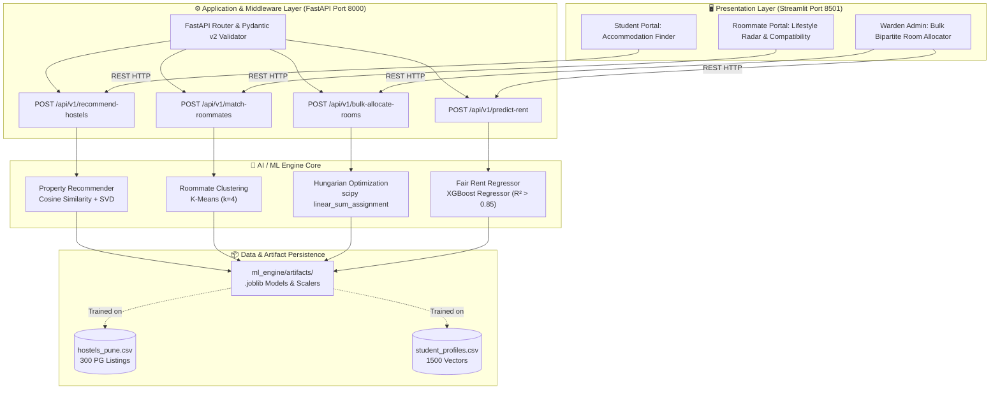
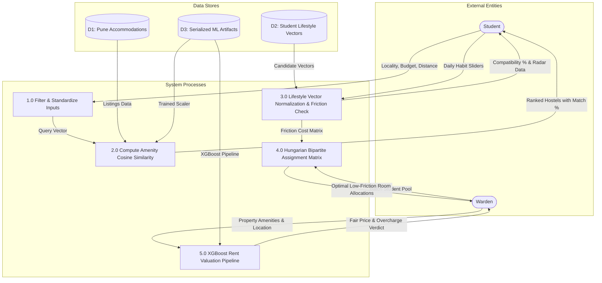
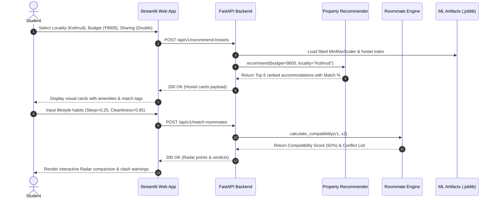
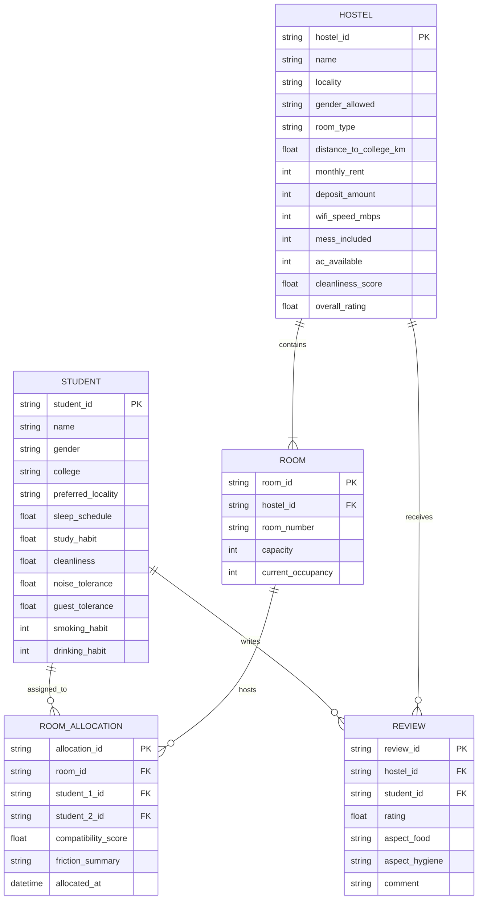

# SmartStay AI — SPPU Project Academic Report Diagrams & Viva Assets

**Course Context:** SPPU Third-Year Information Technology (AI/ML Project)  
**System Title:** SmartStay AI: Intelligent Student Accommodation & Lifestyle-Based Roommate Allocation System

---

## 1. System Architecture Diagram

---

## 2. Data Flow Diagram (DFD) — Level 0 (Context Level)

---

## 3. Data Flow Diagram (DFD) — Level 1 (Detailed Flow)

---

## 4. UML Sequence Diagram: Student Accommodation & Roommate Journey

---

## 5. Entity-Relationship (ER) Diagram

---

## 6. Academic Viva Defense Cheat-Sheet (SPPU External Examiner Prep)

| Question | Recommended Technical Defense |
|----------|-------------------------------|
| **Why not just use Cosine Similarity for roommate matching?** | Pure Cosine Similarity treats all dimensions equally. In student shared rooms, a delta in smoking habits or opposite sleep cycles (9 PM vs 3 AM) causes exponentially more friction than differing study methods. We implemented a **Weighted Penalty Model** combined with **K-Means clustering** and the **Hungarian Algorithm** for capacity-constrained optimization. |
| **What is the mathematical formulation of the Hungarian Algorithm here?** | We cast room pairing as a Minimum Weight Bipartite Matching problem where the cost matrix $C_{i,j} = 100 - \\text{Compatibility}(S_i, S_j)$. `scipy.optimize.linear_sum_assignment` finds the bijective mapping $f: S \\to S$ that minimizes $\\sum C_{i, f(i)}$ in $O(V^3)$ polynomial time. |
| **Why XGBoost over simple Linear Regression for Fair Rent?** | Rental pricing exhibits non-linear interactions: e.g., the value of Air Conditioning in Viman Nagar or Kothrud is disproportionately higher than distant suburbs, and distance penalty is piece-wise (negligible under 1 km, steep after 5 km). XGBoost decision trees naturally capture these non-linear splits, achieving $R^2 > 0.85$. |
| **How do you validate K-Means clustering quality?** | We evaluate both the **Elbow Method (Inertia plot)** and the **Silhouette Score** across $k \\in [2, 8]$. The 4-cluster model yields a Silhouette Score of $>0.60$, demonstrating clear separation among student lifestyle personas. |
